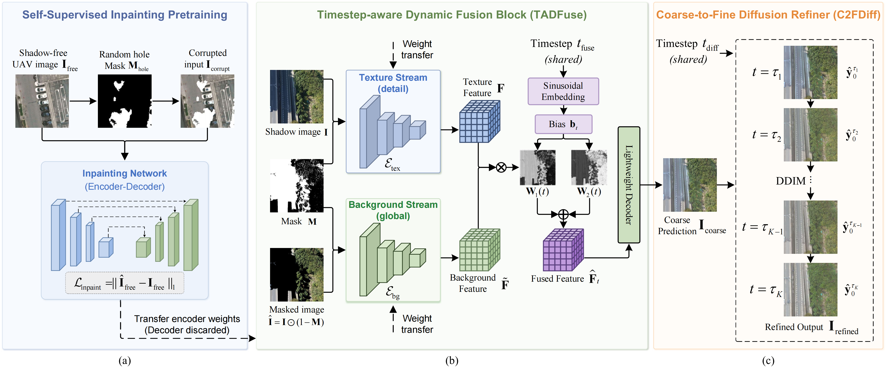

# FuseDiff

This is the official implementation of the paper **"Fusion and Diffusion for Timestep-Aware UAV Shadow Removal"**.

## TODO

- [x] Release inference code.
- [x] Release pretrained models.
- [ ] Release training code.

## Overview

Shadow removal in uncrewed aerial vehicle (UAV) imagery faces two key challenges:

- **Lack of explicit coarse-to-fine restoration modeling:** Existing methods often lack explicit control over the progressive transition from global illumination correction to fine-grained texture recovery.

- **Lack of unified stage-wise coordination:** Restoration stages are often processed independently, without a unified mechanism to coordinate illumination correction and texture refinement throughout the restoration process.

FuseDiff consists of three key components:

- **Self-Supervised Inpainting Pretraining:** Learns structural and textural priors from shadow-free images without requiring paired supervision.
- **Timestep-Aware Dynamic Fusion (TADFuse):** Progressively integrates illumination and texture features under timestep guidance.
- **Coarse-to-Fine Diffusion (C2FDiff):** Refines coarse restoration results through conditional diffusion sampling.



## Requirements

The implementation is based on Python and PyTorch.

Install the required dependencies using:

```bash
pip install -r requirements.txt
```

A CUDA-enabled GPU is recommended for inference.

## Datasets

The datasets used in our experiments are provided below.

- UAV-SC: [ESC-Net](https://github.com/fzzfRS/ESC_Net)
- SRGTA: [RMMamba](https://github.com/xgd-cj/RMMamba)
- RS-SynShadow: [RS-GSSR](https://fzzfrs.github.io/RS-GSSR/#resources)

The current framework requires corresponding shadow masks as input. Since the UAV-SC dataset does not provide official shadow masks, we release the test masks used in our experiments available in [Google Drive]([https://drive.google.com/file/d/1KvzqoG8hsHTMWubPm4QgXKWhVBMz_bYX/view?usp=drive_link](https://drive.google.com/file/d/1os8pLG30hZvoEcdtni4q6OU75h37mqI0/view?usp=drive_link)).

## Pretrained Models

Please download the pretrained FuseDiff model and place it in the designated checkpoint directory.

- **FuseDiff:** [Google Drive](https://drive.google.com/file/d/1b2i2vOQOqs9Kotvc4-oR9rySnx-bsae9/view?usp=drive_link)

## Inference

To perform shadow removal using the pretrained model, run:

```bash
python tools/crop_tiles.py --images shadow_removal/data/UAV-SC/test/shaded --masks shadow_removal/data/UAV-SC/test/mask --output shadow_removal/data/UAV-SC/test/tiles --tile-size 1024 --overlap 128
python shadow_removal/test.py --config "config_UAV-SC_tiles.yml"
```

